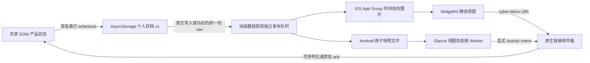

# 一日一念：iOS / Android 桌面小组件实施评估

评估日期：2026-10-11（北京时间）。基于本地 HEAD `0313ca98a90c496ada6e7472cabf42542c21ae3c`（PR #24），以及当日可访问的 Expo、Apple、Android 官方资料和库作者源代码。此次交付为评估文档；没有改造应用、安装依赖、运行 prebuild、云构建、上传或发布。

标记：**已核实**为本地代码或引用资料直接支持；**推断／建议**为本项目的工程判断；**待验证**为未通过实际构建或真机确认。

## 决策结论

**建议实施一个只读“今日仪式”小组件，两种尺寸，整卡点击进入应用内对应场景。保持 Expo SDK 57；iOS 首选官方 `expo-widgets`，Android 首选轻量 Jetpack Glance 原生模块和本地 config plugin。** 两平台共享推荐算法、快照和链接协议，视图分别实现。首版以基础离线场景为范围，应用继续独占个人存档的写权限。

选择原生 Android 的理由是：本产品只需几项文字和图像，但需要在 React／DOM 页面关闭后读磁盘、核对日期和刷新。Glance 可以直接完成这些工作。社区包可以降低 UI 原型成本，不过其 RN 0.86.3 兼容性尚无明确证据，并引入 Headless JS 的启动和后台适配。原生实现的额外成本集中在一个小模块，无需重写整个产品。

这项工作有明确可行路径，尚未达到“可发布”验证层级。优先做最小原生验证：签名安装后能添加两个尺寸、应用关闭后仍显示、整卡冷启动进入正确场景。通过后再投入完整视觉和回归；若 iOS 官方抽象无法满足后续长期时间线／隐私逻辑，转 Swift WidgetKit；若 Glance 的编译依赖整合成本超出首版收益，改用简单 RemoteViews。

## 本地代码与发布基线

本轮检查工作区及父目录，没有找到适用的 `AGENTS.md`。开始时 Git 仅有 `docs/mobile-app.md` 的未提交修改；其 Wi-Fi 排障和 iPhone Expo Go 验证记录保留。8082 的 LAN Expo 服务属于用户正在使用的测试环境，本轮只读核实监听，未停止、重启或占用端口。

| 核实对象 | 当前实现及其影响 |
| --- | --- |
| [根 package.json](../package.json)、[锁文件](../package-lock.json)、[移动依赖](../apps/mobile-expo/package.json) | npm workspaces、根唯一锁文件；实际锁定 Expo 57.0.27、RN 0.86.3、React／React DOM 19.2.3、WebView 13.16.1、AsyncStorage 2.2.0。`expo-widgets`、`@expo/ui`、`expo-linking`、`expo-dev-client` 尚未作为移动端集成依赖安装配置。SDK 本地推荐表给出 widgets ~57.0.23、UI ~57.0.22、linking ~57.0.12、dev-client ~57.0.19；实施时按 SDK 安装并锁定实际解析版本。 |
| [App.tsx](../apps/mobile-expo/App.tsx) → [BlessingDom.tsx](../apps/mobile-expo/BlessingDom.tsx) → [共享 App](../packages/app/src/App.tsx) | RN 原生壳提供存储／生命周期；`'use dom'` 页面在独立 WebView 中运行。桥是顶层异步 props，原生和 DOM 不共享内存。当前仅传 `active`、返回请求和资源／存储动作，没有链接请求和消费确认。 |
| [Metro](../apps/mobile-expo/metro.config.js) | 保留工作区监视、React 单实例、跨 checkout 缓存区分、DOM 开发启动中间件。小组件入口属于原生侧；不能让它导入 DOM 产品入口、CSS 或 Three.js。 |
| [今日](../packages/app/src/home.tsx)、[推荐规则](../packages/app/src/scene-placement.ts)、[场景目录](../packages/app/src/scene-library.tsx) | 今日主仪式从 6 个祈福＋5 个许愿场景交错排序，按本地 `YYYY-MM-DD` 字符码和轮换，筛选目录可用项；不是从 core 的木鱼／纸鹤／灯三种仪式随机抽签。`dailyPrimaryScene` 必须共享复用。当前目录有 11 个内置场景；发布 profile 未配置线上目录。 |
| [今日预览](../packages/app/src/daily-scene-preview.tsx) | PR #24 加入 WebView 内实时 Three.js 预览，有资源加载、前后台和降级逻辑。小组件应复用场景 ID／标题／美术素材，另做静态视图，不能复用此 canvas。 |
| [core State／restore](../packages/core/src/index.ts) | 整份 JSON `version: 1`：`wishes`、`activeSession`、`sessions`、`collectibles`、`ledger`、`settings`、`sceneRecords`。旧 v1 缺少 sceneRecords 时补 `[]`；读取或校验失败保留原文。存档没有持久化的 revision 或跨进程事务协议。 |
| [runtime 保存](../packages/runtime/src/index.ts)、原生 `writeSave` | 主键 `cyber-bless:personal:v1`。runtime 每次有效 dispatch 先更新内存，再串行写整份快照；native 再以 Promise 队列串行执行 AsyncStorage.setItem。最新 revision 的写入 resolve 后状态才为 `saved`；失败为 `save-error`。`flush()` 的队列已捕获错误，不能只等 flush 就认定成功。 |
| [心愿](../packages/app/src/wishes.tsx)、[仪式](../packages/app/src/ritual.tsx)、[场景结算](../packages/app/src/scene-experience.tsx) | dispatch 返回“内存是否改变”，不代表已落盘；许愿后导航、收藏切换、完成动画可能先出现。小组件必须用实际已提交的 raw，不能在这些 UI 回调中取最新 state 就宣布已完成。 |
| [页面／收藏](../packages/app/src/pages.tsx) | 心愿有 active／realized／fulfilled 及独立 archived；`sceneRecords.favorite` 是场景收藏开关，`collectibles` 是小天地珍藏，两者不同。今日已收下由 `daily:<day>:<sceneId>` 珍藏判断；一次 daily.scene 产生 10 功德，重复结算不再发放。 |
| [路由](../packages/app/src/context.tsx)、共享 App | 自建 `Route[]` 内存栈，每次挂载初始为 today；没有 Expo Router、URL/hash 路由或持久化导航。打开 scheme 目前不能自动进入心愿／场景。场景打开还涉及 `daily`、`vessel`、`wishId` 与进度重置，须经过现有 `useOpenScene` 流程。 |
| [日期](../packages/app/src/local-day.ts)、core `localDay` | 设备本地日期；DOM 在可见时、每分钟和 App 回前台时检查。应用关闭后这个计时器不执行，不能驱动桌面更新。 |

发布身份来自 [app.json](../apps/mobile-expo/app.json)、[eas.json](../apps/mobile-expo/eas.json)，与 [移动文档](mobile-app.md)、[发布记录](store-release.md) 相符：主应用 iOS Bundle ID／Android package 均为 `com.helio.cyberbless`；scheme `cyber-bless`；Apple Team `6PG2WW6L6N`；EAS project `8bd96afd-5d35-4c3c-8ccc-3735696a4973`；ASC App ID `6821271597`。preview 为 APK／Ad Hoc，production 为 AAB／商店 IPA，production 使用远程构建号递增。

已有包检查记录显示 iOS 最低 16.4、Android minSdk 24／targetSdk 36，iOS4、Android3。这些包早于最近产品合并，**没有小组件，也没有当前 HEAD 的全部功能**。本轮没有重新查询云端状态；发布记录中的 Apple 上传成功、Play 身份验证／应用记录／服务账号阻塞属于此前核查结果，实施或发布时需复核。

## 产品候选与首版范围

| 候选 | 展示／点击 | 价值与额外成本 | 优先级 |
| --- | --- | --- | --- |
| 今日仪式 | 当地日期、主仪式标题、静态场景图标、通用寄语；可选显示已确认的“今天已收下”。点击重新核对今日推荐，进入 scene。 | 与现有首页主入口一致；公开内容为主，能离线预计算；无用户选择和第二个 writer。 | 首版唯一 kind |
| 心愿提醒 | 默认“给心愿留一点时间”；经用户选定才展示一条未归档心愿的短标题。点击 wish 或 wishes。 | 有回访价值；需新增选定心愿、隐私显露开关、归档／失效处理。不是系统通知或定时闹钟。 | 第二阶段 |
| 收藏展示 | 一件小天地珍藏的静态图和标题；点击 collection 或按回看规则打开 scene。 | 能表达积累；需明确选择 collectibles 还是 sceneRecords.favorite、空态和多实例配置。先单件，轮换仍受系统刷新调度。 | 第二阶段 |

首版 iOS 只声明 `systemSmall` 和 `systemMedium`；Android 提供约 2×2／4×2 的紧凑和宽卡，按 dp 可用空间响应式布局，网格占位不等于跨设备固定像素。小卡仅标题／图标／日期，宽卡增加寄语和状态。两尺寸都只有一个整卡入口，静态图片或原生图形，无音效、木鱼敲击、持续动画或直接写心愿。大尺寸、iPad extra-large、锁屏 accessory、Live Activities 和多入口配置不进入首版。

默认不展示心愿正文、笔记、关联心愿名、累计功德或私人数量。若连“今日已收下”的行为状态也希望隐藏，可关掉该行，卡片仍有完整价值。预览图库只能使用通用文案。将来增加心愿卡时，要先解释桌面可被旁人看到，主动选择显露，支持立即隐藏和重建快照，且不把正文放进链接或日志。

## 最小共享快照与保存语义

**建议保留 v1 个人存档原位，新增可重建的小组件缓存。** iOS 扩展不能直接读取主应用沙箱里的 AsyncStorage；Android 即使使用同包存储，也不应依赖 AsyncStorage 内部文件／数据库布局。主应用完成读取校验或原生写入后，派生独立 JSON；小组件只读该投影。快照不是第二份完整备份，也不承担业务结算。



拟定 schema，属于接口设计，当前尚未存在：

```ts
type WidgetSnapshotV1 = {
  schemaVersion: 1;
  sourceVersion: 1;
  sourceHash: string;        // 已确认 raw 的哈希，用于去重；不含原文
  catalogRevision: string;   // 当前内置目录及推荐规则版本
  generatedAt: string;       // ISO 时间戳
  timeZone: string;          // 生成时的 IANA 时区；无法取得时记录 offset
  validThroughDay: string;
  days: Array<{
    day: string;             // 设备当地 YYYY-MM-DD
    sceneId: string;
    title: string;
    category: 'blessing' | 'wish';
    artKey: string;          // 内置素材白名单，不接受任意文件或网络 URL
    collected: 'confirmed' | 'unknown';
    deepLink: string;
  }>;
};
```

建议一次生成当天＋未来 6 天，并安排第 8 天起的通用“打开一日一念，看看今天的仪式”条目。这里的 7 天是首版工程取舍，不是系统限制；原生 Android worker 选择当前日期对应项，iOS 将其映射为时间线。未来日期不预先标成已完成；无法确认时不用“尚未完成”，只给中性邀请。当前已收下也必须匹配快照日期与 `dailyCollectibleId`。所有图片在发布新快照前准备完成，缺图退回图标；小组件单独使用小图，不能把 GLB、全屏截图和网页字体包带入扩展。

实施顺序及失败处理：

1. 从 `scene-placement.ts` 提取纯推荐函数、场景元数据到无 DOM／React／Three.js 依赖的共享模块，并让 Today 与原生投影使用它。保持排序、日期算法和 available entries 一致。当前可用内置目录为准；将来启用线上目录时，增加“已验证目录版本／可离线打开”的投影，不能复制完整 manifest URL 让小组件自行下载。
2. native `writeSave(raw)` 在 AsyncStorage.setItem 成功后捕获**本次 raw**，加入独立的 widget 发布队列。连续 S1／S2 写入要按已提交顺序发布，合并相同投影、丢弃晚到的旧任务；不能由 S1 的完成回调读取可能尚未保存的 S2 内存。当前个人存档缺少持久化 revision，缓存用原文哈希＋串行顺序即可，不能把时间戳当跨 writer 冲突协议。
3. 小组件缓存写入或 reload 失败，保留旧的完整缓存并记录独立同步失败／重试，不能让已经成功保存的主存档被误报为“尚未保存”。不要把 widget 更新 Promise 直接作为原生主存档写入失败返回。缓存发布本身也串行，Android 用 AtomicFile 等完整替换，iOS 交给库的 App Group 时间线存储；不让 worker 回写个人存档。
4. 保存状态的业务确认仍以 runtime 最新写入结果为准。`status === saved` 在新安装读取空档时只表示加载完成，未必发生过写入；这时可生成公共推荐和空态，不伪造个人操作。读档损坏／load-error 时保留原文、禁用个人状态投影，只显示公共入口。
5. 成功读档、回前台、日期／时区改变、目录版本变化、保存确认和显露偏好变化时补建快照。应用在“主档成功、缓存未写”之间被系统杀死，下次从主档重建；不要依赖后台 `void queue` 或 `flush()` 获得无限运行时间。
6. 快照独立带 schemaVersion。未知版本／损坏／缺失用通用入口，不按空存档覆盖主档。升级时由有效主档重新生成；旧 v1 的 sceneRecords 补齐规则继续沿用。清空／导入／恢复能力若未来加入，同步失效快照和图片；卸载重装不承诺保存或恢复，本项目没有跨设备迁移。

### 跨日、时区和长期关闭

产品继续使用**设备当前本地日期**，不是固定中国时区或 UTC。逐日边界按本地日历计算，不简单累加 24 小时；处理 DST、手动调时和跨时区旅行。快照保存生成时区，便于识别其 UTC 条目时间已经过时。每个视图显示明确日期；点击后始终重新算当天，链接中的 day 只是上下文。

iOS `environment.date` 是条目日期，不能当持续变化的“现在”。预写时间线能覆盖应用关闭后的几天，但官方 SDK57 provider 只读取存储条目；时间线结束不会自行运行产品算法。必须有明确终止占位。跨时区导致既有条目时间偏移、系统延迟导致旧画面仍在、长期不打开后的刷新行为需要真机验证。即使希望隐藏过期内容，已被系统保留的旧画面也无法由未运行的 JS 立即修改，所以明确日期和点击复核是必需防线。若要求长期关闭后仍无限生成当地当天内容，选自定义 Swift provider 并维护共享规则／测试向量，增加成本。

Android 推荐 `updatePeriodMillis=0`，有效保存后主动请求更新，另用原生唯一 WorkManager 任务做低频补偿（例如 6 小时）和下一本地日界的延迟任务；都不保证准点。只有安装小组件时保留周期工作，最后一个实例删除后取消。worker 只读本地快照、选日期或过期占位，不启动 DOM、联网或重复写主档。TIME_SET／TIMEZONE_CHANGED 可按需要注册，系统例外见 [Android 广播限制](https://developer.android.com/develop/background-work/background-tasks/broadcasts/broadcast-exceptions)；不能假定 DATE_CHANGED 的 manifest 广播一定可用。重启依靠 WorkManager 的持久调度并验收解锁后恢复；更新包使用本应用更新事件补建／失效旧缓存。Doze、force-stop 和 OEM 省电仍会延迟工作，此时保留有日期的旧卡；再次打开应用后修复。

## 点击与原生／DOM 路由补充

建议版本化链接协议，下面是**拟实现**的链接，而不是已存在的入口：

| 链接 | 验证后行为 |
| --- | --- |
| `cyber-bless://widget/today?v=1&day=YYYY-MM-DD&scene=woodfish` | 计算当前本地日期与当前主仪式。仍为同日同场景时按 `useOpenScene(entry, {daily: currentDay})` 打开；过期或推荐改变时进入当前 today，并清楚提示已切换日期，用户再打开当日仪式。不能照搬传入 day 结算。 |
| `cyber-bless://widget/wish?v=1&id=...` | 后续候选：读档后验证心愿存在和显露选择；归档／已还愿／选择被取消时降级到 wishes。 |
| `cyber-bless://widget/collection?v=1&id=...` | 后续候选：验证珍藏存在，再进入 collection；失效进入 world。回看不得带 daily 或生成新奖励。 |

原生 App 加 `Linking.getInitialURL()` 和 URL 事件监听（可用 RN Linking，或按 SDK 安装 expo-linking），覆盖 cold／warm start；不能只加 scheme 配置。[Expo 链接处理](https://docs.expo.dev/linking/into-your-app/) 区分这两条路径。iOS 根视图使用单个 `widgetURL` modifier；Android 使用显式指向本应用 Activity 的 Intent／PendingIntent，携带 URI。两个尺寸同一目标，避免多个可点击区域的歧义。

新增可序列化 `navigationRequest={requestId, target, id?, day?, sceneId?}`，从 App → BlessingDom → BlessingApp；新增顶层异步 `onNavigationHandled(requestId)` 回桥确认。原生保留未确认请求，直到有效读档、目标可解析且页面完成切换；DOM 重建／读档重试前不丢事件。去重 startup 初始 URL 和同一次事件，重复点击同 URL 仍可产生新请求。桥回调延续现有 ref／稳定 host 模式，不能因 prop 更新重建 store 或重读空档。[DOM props／动作约束](https://docs.expo.dev/guides/dom-components/) 支持这条通信方式。

消费逻辑应放在 SceneLibraryProvider 内可调用 `useOpenScene` 的位置，不能只调用 `go({page:'scene', id})` 跳过初始化。当前 provider 的 `ready` 只代表缓存维护完成，不能推断线上目录已加载；首版以内置目录立即解析，未知场景／引擎降级到 today。链接只接受 scheme、host、path、版本和白名单 ID／严格日期；不接收任意 entry、manifest、文件路径、vessel 或业务 action。

暖启动可能停在未提交的心愿文本、还愿草稿或未保存页面。当前表单有本地 state，部分草稿不在个人存档里；等 flush 不能保住这些输入。新增导航处理需识别 dirty／save-error／正在仪式中的状态，保留输入并显示待打开入口，由用户完成或放弃后再切换。无草稿时直接导航。cold start 读档失败保留请求并提供恢复，不先覆盖为默认空档。返回栈建议 `[today, scene]`，返回回今日；点击本身不在 widget 端完成或结算仪式。应用内正常走场景时仍会按现有逻辑写访问／进度，重复 daily 结算继续由 core 去重。

## 直接交互为什么另作阶段

系统本身允许 iOS17+ App Intent／Button 和 Android callback 改状态，但库里更新小组件 props 不等于更新 `cyber-bless:personal:v1`。Expo widget 交互监听仅在 app 进程存活时触发；不能把它当应用关闭时可靠的业务提交接口。

现有双层 Promise 队列只协调各自的 JS／原生壳生命周期。若 Widget extension／Headless JS 读 S0 修改为 S1，同时 DOM 写 S2，整份 JSON 的后写会覆盖另一方；现有存档没有 compare-and-swap、跨进程锁或幂等 action 日志。直接“标记心愿实现／完成仪式”还会改变 notes、sessions、collectibles 和 ledger，多字段不能分别乐观修改。

首版因此只读＋跳转。未来若要直接交互，先设计统一 native 数据仓库或原子 action 收件箱：持久化 operation ID、跨进程提交／幂等消费、前台冲突合并、业务 reducer 等价实现、失败确认和对账，再考虑把个人存档迁到共享容器或其他事务存储。只做 widget 自身视觉勾选并在下次打开应用补写，不能显示成业务已经保存。成本明显高于新增按钮，须独立评估；避免为了首版只读展示提前迁移主档。

## 构建、配置与签名工作清单

继续当前 CNG／managed 方式；原生源码和插件放入可上传的源码目录，让 prebuild 可重复生成。当前 [.easignore](../.easignore) 排除了 `apps/mobile-expo/ios`、`android` 和两个生成 public 目录，单独手改生成的 Xcode／Manifest 文件不会可靠进入云构建。[Expo CNG](https://docs.expo.dev/workflow/continuous-native-generation/) 与 [config plugins](https://docs.expo.dev/config-plugins/introduction/) 说明生成关系。

| 文件／位置（新增项为建议路径） | 实施动作与验证结果 |
| --- | --- |
| `apps/mobile-expo/package.json`、根锁文件 | iOS 加 SDK57 widgets／UI；调试加 dev-client；Android 自建模块依赖纳入 workspace／Expo autolinking。安装后 check 兼容、typecheck、锁定版本。不顺便升级 Expo／RN。 |
| `packages/core` 或独立纯模块及 exports、共享 Today | 提取推荐元数据／算法、快照校验及投影；避免通过 @wbr/app 主入口让原生引入 DOM／CSS。新增日期和结算一致性测试。 |
| `apps/mobile-expo/App.tsx`、`BlessingDom.tsx`、`packages/app/src/App.tsx`／场景 provider | 保存成功后的发布钩子、链接收件箱／ready ack／dirty guard、前台与日期同步。保留现有存档键和错误屏障。 |
| `apps/mobile-expo/widgets/TodayWidget.tsx`、`widget-sync.ts` | iOS `'widget'` 纯函数、2 个 families、props 时间线、过期占位。数据计算在 native app 侧；widget 函数不能访问模块级常量／应用 context。 |
| `apps/mobile-expo/app.json` | 加官方 widgets plugin、专用 extension ID 和 App Group；核对生成的 main／extension entitlements。保留 bundle、package、scheme、owner、projectId、Team 和现有权限限制。 |
| `apps/mobile-expo/modules/blessing-widgets/` | Android 本地 Expo module：Kotlin GlanceAppWidget／Receiver、快照原子写读、Worker、Gradle依赖、`expo-module.config.json`。源码带 provider XML、initial／preview layout、strings 和图片资源。 |
| `apps/mobile-expo/plugins/withBlessingWidgets.cjs` | Android 生成 manifest receiver／APPWIDGET_UPDATE／provider meta-data，尺寸、resizeMode、home_screen、updatePeriodMillis；如有调时广播则按平台规则注册。核对 exported 和显式 PendingIntent 行为，不复制样例过宽的 intent filter。|
| 静态素材与 `scripts/prepare-app-assets.mjs`、`.easignore` | 从合法可发行的本项目素材生成小图／预览图；图片进入 Android resources，iOS native app 复制到 widgetsDirectory。若新增根 `assets/widgets/`，增加归档白名单。public 是生成目录，不能放手工唯一源；旧时间线仍引用的共享图不提前删除。 |
| `apps/mobile-expo/eas.json`／根 scripts | 新 development profile（developmentClient、internal），独立 dev-client 启动脚本；现有 start 默认 `--go`。保留正在使用的8082 Go服务；实施调试时选其他经核实空闲的端口。profile 保留本应用 Team／远程签名和生产递增。 |
| `scripts/check-mobile-framework.mjs`、`verify-eas-archive.mjs`、包检查 | 保留 DOM 导出／九项资源验证，增加新源码／小图归档断言和原生构建后 `.appex`、签名 entitlement、Android provider／资源检查。export:embed 成功不能证明 extension 编译／签名成功。 |
| `docs/mobile-app.md`、`store-release.md`、隐私与商店描述／截图 | 实施完成再更新真实构建号、验证和加入小组件步骤；保留本轮已有修改。展示个人内容时补充桌面显露说明。新增原生目标需新安装包，当前项目未配置可替代原生升级的 OTA 流程。 |

iOS 官方 plugin 的拟配置片段（并入当前 plugins 数组；不是覆盖整个 app.json）：

```json
[
  "expo-widgets",
  {
    "bundleIdentifier": "com.helio.cyberbless.widgets",
    "groupIdentifier": "group.com.helio.cyberbless.widgets",
    "widgets": [{
      "name": "BlessingToday",
      "displayName": "今日仪式",
      "description": "为今天留一点温柔",
      "ios": { "supportedFamilies": ["systemSmall", "systemMedium"] }
    }]
  }
]
```

扩展 ID／App Group 是建议的新标识，**尚未在 Apple 注册**；主应用仍是 `com.helio.cyberbless`，不要替换成参考应用身份。main 和 extension 均需同 Team 的 `com.apple.security.application-groups` entitlement，extension 被嵌入 `PlugIns/*.appex`。库通常生成 EAS target 声明；必须核对 introspect 输出中的 `extra.eas.build.experimental.ios.appExtensions`（targetName、bundleIdentifier、entitlements），不要重复添加冲突目标。[EAS 扩展支持](https://docs.expo.dev/build-reference/app-extensions/) 的 CNG 签名发现仍标 experimental，这与 SDK widgets stable 是两种不同状态。

App Groups 加入后，主应用 Ad Hoc／App Store profiles 要重新生成或更新，并为 extension 分别建立匹配分发类型的 profile；development 也要匹配调试设备。可沿用同 Team 有效证书，不能沿用缺少 group 的旧 profile。自动同步和 profile 更新依据见 [EAS capabilities](https://docs.expo.dev/build-reference/ios-capabilities/)、[Apple App Groups](https://developer.apple.com/documentation/xcode/configuring-app-groups)。核对主 app 和 appex 的 Team／application-identifier／group，两个目标版本和构建号一致；检查 UserDefaults 等 required-reason API 的 Privacy Manifest，不直接复制未知理由。

Android 没有独立 widget 包名和签名，它随本应用 APK／AAB 分发；保留已有 EAS keystore／上传密钥，Play App Signing 建立后分别记录上传和分发证书。新增 native provider／Worker 不需要心愿权限、定位、exact alarm 或常驻通知。更新沿用远程递增号，不用旧 iOS4／Android3号重传。开发包若使用不同 Android 签名，不能覆盖同包名旧包；不要为安装调试包卸载有记录的现有应用，优先用测试设备，并在升级测试中核对同签名安装。

### 每种环境可验证什么

| 环境 | 能验证 | 不能据此认定 |
| --- | --- | --- |
| 当前 iPhone Expo Go／8082 | 原有 DOM 产品、路由桥协议的模拟输入、主档读写和前台行为；用户已确认能进入。 | 本应用 App Group／extension／Android provider，桌面添加或独立包离线。Go 与独立应用存储不是升级关系，记录不会自动迁移。 |
| Windows＋现有 Node／JDK／adb／Android SDK | 纯逻辑／Web／DOM验证；后续可用 Android Studio／Gradle 编译原生 Android、emulator／真机调试。当前发现相关工具，不等于已核实全部 compileSdk／NDK／Gradle 环境。 | iOS 原生编译、Simulator、SwiftUI preview和Xcode调试；`eas build --local` 在 Windows 不是官方支持路径。 |
| macOS＋匹配 Expo57 的 Xcode／CocoaPods | iOS extension 编译、Swift／WidgetKit调试、模拟器跨尺寸及 entitlements 排查。 | debugger 下正常刷新不能证明真实省电预算。 |
| EAS development build | 安装带自身原生模块和扩展的 client，连接 Metro，添加／点击本应用 widget；Windows 可发起后续云构建。 | 必须退出 Metro／debugger 验证的 release 离线、签名升级、预算和长期关闭行为。 |
| 新 preview／production 包 | 含 extension／provider 的独立安装、飞行模式、后台／冷启动；TestFlight／Play 包做分发和升级验证。 | build success／上传 success 不等于真机通过或商店审核通过。 |

工具环境依据：[development builds](https://docs.expo.dev/develop/development-builds/introduction/)、[EAS local build 限制](https://docs.expo.dev/build-reference/local-builds/)、[EAS云构建](https://docs.expo.dev/build/)。Windows 不阻塞 EAS 产出 iOS 包，但若走自定义 Swift 或排查原生故障，Mac／Xcode能显著减少等待；首版计划至少安排 iPhone 真机以及 Android 真机，Mac资源未在本轮确认。

## 分阶段实施和验收

以下是后续实施任务，**本轮未执行**。有双平台原生经验的一名工程师可按约 10–18 个工作日粗排，属于工程估计；设备准备、签名注册、云排队、商店审核和兼容性修复不计入确定工期。

| 阶段 | 任务／交付门槛 | 粗估 |
| --- | --- | --- |
| 0：原生可行性验证 | 冻结锁文件基线；隔离生成 native 项目；iOS official 小卡＋AppGroup＋widgetURL，Android Glance 1.2.0小卡＋URI；验证2尺寸、cold start和release安装。检查Gradle／Kotlin／Compose依赖，不照抄release页alpha示例。失败时决定RemoteViews／Swift备选。 | 1–2天 |
| 1：共享数据与链接 | 纯推荐模块、版本化快照、已提交raw发布、失败独立重试、7天＋过期、导航ready ack／dirty guard／参数校验。单测保存乱序、失败和日期边界。 | 2–4天 |
| 2：iOS产品化 | 2尺寸静态UI、widgetsDirectory资源、themes、时间线、empty／expired、生成配置、profiles及包检查。 | 2–3天 |
| 3：Android产品化 | 2种dp布局、Glance native读快照、原子存储、唯一Worker及广播、删除最后实例取消任务、manifest和离线资源。 | 3–5天 |
| 4：设备回归与发布准备 | 下表实机、更新已有包保留存档、留证据；新preview／production号和商店资料对齐。构建／上传／提审另按用户授权推进。 | 2–4天 |

社区 Android 原型作为阶段0的限时备选，需证明 RN0.86.3 新架构和 release Headless JS 可用后才能替代原生方案；不会仅凭 peerDependencies `*` 选定。未来心愿／收藏和直接写业务状态分别立项，不夹入首版。

| 验收／回归项 | 通过条件 |
| --- | --- |
| 安装与添加 | iOS16.4及17+／当前系统、Android24及31+／当前系统；安装并首次启动应用后widget图库可见、预览正确，无有效快照有公共空态；添加两尺寸、多实例、缩放、删除再加均正常。 |
| 点击 | 关app／进程回收／后台／前台四种状态落到正确目标；iOS小卡整块均可点击；Android至少两个launcher及一个有强省电策略OEM；无重复导航／重复奖励，失效ID安全降级。 |
| 读写一致 | 创建、记一笔、实现、还愿、归档、收藏、daily结算在write成功后才投影；模拟S1成功S2失败、桥重建、重试和缓存失败，widget不会显示未确认S2，也不会使主档成功误报失败。 |
| 存档／升级 | 从同签名旧包覆盖更新，v1缺sceneRecords、已有activeSession、心愿关联、spentAt、daily珍藏均保留；损坏主档不覆盖；未知widget schema使用公共占位并重建。 |
| 午夜／时区 | 应用关着跨日、7天后过期、月年界／DST／调时、亚洲与美洲往返；日期明确、点击按当前当地日期复核。调度延迟记录真实范围，不要求系统不保证的00:00准点。 |
| 后台／电量 | iOS退出debugger、低电量、冷重启；Android Doze／app standby／force-stop／重启解锁／最后实例删除。允许后台延迟但无崩溃、唤醒循环或持续CPU／网络。 |
| 离线 | 无Metro、飞行模式、native app被杀仍显示已有widget；点击可离线打开11内置场景。远程场景候选不在首版；缺图片／缓存可读文字与通用入口。 |
| 输入与路由 | 暖启动链接不丢未提交文本／还愿草稿；save-error保留页面和待消费请求；读档重试与WebView渲染进程恢复后继续处理。Android返回层级与原有弹窗返回不退化。 |
| UI／无障碍 | 浅／深／iOS tinted／低亮，Android动态色与不同launcher padding；系统大字体、中文长标题、VoiceOver／TalkBack、触点和对比度通过。Web的WOFF2／CSS不会自动作用于原生widget，首版优先系统中文字体。 |
| 核心产品 | 11场景今日推荐与首页完全一致；日收藏一场10功德且幂等；回看不领奖、许愿容器只消耗一次、归档／还愿／收藏无回归；当前Three.js首页预览、离线资源和法务入口继续通过原有verify。 |
| 包和资料 | IPA确有已签名appex与正确AppGroup／构建号，APK／AAB有provider和资源且签名连续；原DOM打包／归档验证通过。商店说明和截图对应这个新包，不使用旧包或浏览器截图证明widget实机能力。 |

实施验证使用现有 `npm run verify`、`mobile:archive:verify` 加新增的纯逻辑和native checks；生产导出后仍须实际native build和设备验收。本轮只有文档变化，没有重跑全量应用构建或业务测试。

## 需要决定的最少事项与实际阻塞

**仅需决定是否启动上述首版实施。** 产品和工程默认范围已足够明确：今日仪式、两尺寸、只读、无心愿原文、保留SDK57、允许系统刷新延迟。若用户要求“桌面直接完成仪式”“默认显露心愿”或“长期关闭仍严格当天且午夜准点”，则属于范围变化，先补相应设计；精确午夜不是换一个包就能保证的能力。

| 状态／阻塞 | 影响和下一步 |
| --- | --- |
| 当前没有已安装的小组件模块、目标、snapshot和链接桥 | 是待实施工作，不是平台不可行。本轮保持评估范围，未生成或注册任何目标。 |
| 锁定组合尚未native build／真机验 | 是选择社区包和签名发布前的技术门槛；用阶段0验证，不能沿用已有Expo Go成功来代替。 |
| iOS AppGroup和extension ID／profiles未创建 | 需要同Team注册／同步能力及生成profiles，且持有对应签名访问。现有main证书／身份可沿用；本轮没有访问凭据或更改Apple后台。 |
| 设备与Mac调试资源未确认 | iPhone Expo Go已经可用，但本应用widget需新签名安装；需要能装preview／TestFlight的iPhone和Android设备。Mac对本地iOS调试必需，EAS云构建可以从Windows发起。 |
| 既有商店流程阻塞 | 根据发布记录，Apple联系人／版权发行事实／公开隐私支持URL，Play账号验证／本应用记录／发布服务账号等仍待落实。它们影响分发／提审，不阻止先完成本地实现和Android测试。当前不能声称已有TestFlight邀请或Play测试链接。 |

以下平台依据支撑上面的决策；其中库版本、可用API是资料事实，成本、7天策略和首版范围是本项目建议，所有原生行为还需阶段0与实机验收。

## 平台资料与兼容性依据

### 1. SDK 57 的真实支持边界

**本地已核实**：锁文件和已安装的 Expo 包均为 57.0.27；其 bundledNativeModules 推荐 Widgets ~57.0.23。主应用身份与路由／存档结构已在上文按代码核对；推荐版本不代表本项目已安装或验证小组件。

**官方已核实**：SDK 57 的 [Expo Widgets 文档](https://docs.expo.dev/versions/v57.0.0/sdk/widgets/) 推荐 `expo-widgets ~57.0.23`，声明 iOS 桌面小组件和 Live Activities；不可在 Expo Go 验证，须 development build。页面没有 alpha／beta 标记；[Expo 发布状态规则](https://docs.expo.dev/more/release-statuses/) 定义无状态标记的功能为 stable，因此不能照搬早期 SDK 文档的 alpha 结论。

**源代码已核实**：SDK 57 的 Android [WidgetsModule.kt](https://github.com/expo/expo/blob/sdk-57/packages/expo-widgets/android/src/main/java/expo/modules/widgets/WidgetsModule.kt) 只有模块名称注册；[config plugin](https://github.com/expo/expo/blob/sdk-57/packages/expo-widgets/plugin/src/withWidgets.ts) 中 `enableAndroid` 默认 `false`。这不是已经可用的官方 Android 产品方案。[main CHANGELOG](https://github.com/expo/expo/blob/main/packages/expo-widgets/CHANGELOG.md) 的 58 系列才列出 Android JS bundle、Hermes、组件、交互等实现；不能据此声称本项目 57 已兼容，也不建议为了小组件直接升级应用。

**源代码已核实**：SDK 57 [podspec](https://github.com/expo/expo/blob/sdk-57/packages/expo-widgets/ios/ExpoWidgets.podspec) 最低 iOS 16.4，Swift 5.9；[iOS plugin](https://github.com/expo/expo/blob/sdk-57/packages/expo-widgets/plugin/src/ios/withIosWidgets.ts) 默认 deployment target 16.4（可继承应用设置）、target 名 `ExpoWidgetsTarget`、扩展 Bundle ID `<main>.ExpoWidgetsTarget`、App Group `group.<main>`，并调用生成源文件、App Groups、Xcode target、EAS extension 配置的插件。建议明确声明本应用专用扩展 ID 和 App Group，保留主应用身份与签名连续性。

**源代码已核实**：[SDK 57 类型](https://github.com/expo/expo/blob/sdk-57/packages/expo-widgets/src/Widgets.types.ts) 支持 `systemSmall`、`systemMedium`、`systemLarge`、`systemExtraLarge`（仅 iPad）、`accessoryCircular`／`accessoryRectangular`／`accessoryInline`。`environment.date` 是当前时间线条目的日期，不等于后台不停运行的实时钟；环境还有颜色模式、accented／vibrant 渲染、亮度降低、边距等信息。首版建议仅 small／medium，当前应用 `supportsTablet: false`，无需首版做 extra-large。

### 2. iOS 时间线、渲染与交互

**官方已核实**：Expo 的 `'widget'` 函数处于隔离 runtime，只能同步返回 `@expo/ui/swift-ui` 组件，不可访问应用 hooks／context／内存状态、执行异步操作或直接复用 DOM 页面。数据通过 props 进入；图片放入共享 `widgetsDirectory`。交互 Button（iOS 17+）返回新 props 后可在应用关闭时持久化小组件自己的显示状态；`addUserInteractionListener` 只在 app 进程存活时触发。[Expo Widgets](https://docs.expo.dev/versions/v57.0.0/sdk/widgets/)

**源代码已核实**：[Widgets.ts](https://github.com/expo/expo/blob/sdk-57/packages/expo-widgets/src/Widgets.ts) 的 `updateSnapshot` 写一个立即生效条目，`updateTimeline` 写日期和 props 列表，`reload` 请求重新加载，`getTimeline` 返回已存条目。[TimelineProvider.swift](https://github.com/expo/expo/blob/sdk-57/packages/expo-widgets/ios/Widgets/TimelineProvider.swift) 从 App Group 读取列表，使用 `.atEnd`；[WidgetsStorage.swift](https://github.com/expo/expo/blob/sdk-57/packages/expo-widgets/ios/WidgetsStorage.swift) 用 `UserDefaults(suiteName:)` 存数据。库不会自动在主应用关闭后重新运行本产品“今日仪式”算法。

**推断／建议**：主应用从已确认保存的状态预写未来若干天的只读条目，每天按产品当地日期计算新仪式、重置当日状态，末尾安排“打开应用更新”过期条目；收藏内容可以沿用，但不能伪造未来已完成。不要只 `updateSnapshot` 后期待系统每天唤醒 React／DOM。到期 `.atEnd` 请求同一已有列表也不会创造新内容。未来 N 天范围、条目切换延迟、系统时区／手动日期变更后的纠正需要真机验证；app 每次前台、确认保存和日期切换时重建时间线。

**官方已核实**：[Apple 刷新文档](https://developer.apple.com/documentation/widgetkit/keeping-a-widget-up-to-date) 说明 WidgetKit 在独立进程替应用渲染，扩展不持续运行；更新受动态电量预算约束。经常查看的小组件通常每天 40–70 次刷新、约 15–60 分钟，但非 SLA；24 小时窗口不必午夜重置；推荐提供可预测的未来条目，间隔至少约 5 分钟，系统可能合并更新。即使 Expo 文案说 reload 立即刷新，也应以系统限制为准。[TimelineProvider](https://developer.apple.com/documentation/widgetkit/timelineprovider) 提醒 Xcode 调试不施加同样预算，必须离开 debugger 验收。

**官方已核实**：基础桌面 WidgetKit 起于 iOS 14、锁屏 accessory 起于 iOS 16，但本项目依赖有效最低版为 16.4。[Apple WWDC23](https://developer.apple.com/videos/play/wwdc2023/10027/)。不打开 app 的 Button／Toggle 交互需 App Intent，iOS 17+；按钮语义应完成动作，仅导航用 Link 或 widgetURL。[Apple 交互](https://developer.apple.com/documentation/widgetkit/adding-interactivity-to-widgets-and-live-activities)

**官方已核实**：安装后须至少启动包含小组件的应用一次，才会在 iOS widget gallery 出现。[Apple 创建扩展](https://developer.apple.com/documentation/widgetkit/creating-a-widget-extension)。安装引导与验收应包含这一步；不能把首次尚未打开应用时没有卡片判断为构建失败。

**官方已核实**：整张卡片用一个 `widgetURL`，同层级多次设置行为未定义；多入口可用 `Link`，small 首版建议仍只一个入口。点击会把 URL 交给 containing app。[Apple 深链](https://developer.apple.com/documentation/widgetkit/linking-to-specific-app-scenes-from-your-widget-or-live-activity)。SDK57支持 `widgetURL(url)` modifier，small／medium 首版可在根 view 的 `modifiers` 上设置整卡单目标；实际冷启动落地仍须真机验收。[SDK57 widgetURL](https://docs.expo.dev/versions/v57.0.0/sdk/ui/swift-ui/modifiers/#widgeturlurl)。Expo也提供 `import { Link } from '@expo/ui/swift-ui'`，`<Link destination={props.deepLink}>...</Link>`；其“Included in Expo Go”仅表示应用内 Link，不能推导扩展可用Expo Go。[SDK57 Link](https://docs.expo.dev/versions/v57.0.0/sdk/ui/swift-ui/link/)

**官方已核实**：[App Groups](https://developer.apple.com/documentation/xcode/configuring-app-groups) 要求主应用和扩展加入同一开发团队的共享 group，可共享文件容器和 limited preferences。[UserDefaults](https://developer.apple.com/documentation/foundation/userdefaults) 是未加密设置存储，不适合个人敏感信息。**建议**：首版只公开仪式名称、通用寄语和非敏感状态；心愿原文需单独用户选择。不要把完整个人存档放进 widget props 或深链参数。

**推断／建议**：Three.js／WebGL／WebView 仪式无法直接作为 WidgetKit UI 常驻在桌面；使用静态缩略图、图标和文字，点击后进入应用内完整仪式。以动态倒计时文本或系统有限更新动画替代持续 3D 渲染，不能把 Live Activity 当成普通桌面小组件。

### 3. Android 原生方案

**官方已核实**：Android AppWidget 的显示由 launcher 托管，核心是 RemoteViews；[Glance](https://developer.android.com/develop/ui/compose/glance) 提供 Kotlin 的 Compose 风格 API，但不能直接混入普通 Compose UI。[管理状态文档](https://developer.android.com/develop/ui/compose/glance/glance-app-widget) 说明 Glance 生成 RemoteViews，内存状态可随进程销毁，应用负责持久化并通知更新；不要求前台 Activity／React Native 页面一直运行。

**官方已核实**：[Glance release 页](https://developer.android.com/jetpack/androidx/releases/glance) 当前 stable 为 `1.2.0`（2026-08-26），另有 `1.3.0-alpha02`；1.2 beta 起默认 minSdk 21→23。当前应用 Android 24 的基线满足该已公布最低要求。**待验证**：具体 Gradle、Kotlin、Compose compiler、Expo native template 和依赖解析仍必须用实际 development／release build 核实，不能仅凭 minSdk 宣称集成成功。

**官方已核实**：[基础 AppWidget](https://developer.android.com/develop/ui/views/appwidgets) 限定可用 RemoteViews 控件，不能塞自定义 View 子类；[RemoteViews](https://developer.android.com/reference/android/widget/RemoteViews) 的允许列表没有 WebView／GLSurfaceView。**推断**：共享 React DOM、Canvas／Three.js、网页 iframe／动画不能直接复用到桌面。首版 Glance 小卡片仅文字、Image、简单布局；应用内 WebView 仍负责完整体验。

**官方已核实**：[高级更新文档](https://developer.android.com/develop/ui/views/appwidgets/advanced) 中 `updatePeriodMillis` 至少 30 分钟，设 0 可停用周期更新；耗时任务转 worker，receiver 不应超过约 10 秒。[WorkManager PeriodicWorkRequest](https://developer.android.com/reference/androidx/work/PeriodicWorkRequest) 最小周期 15 分钟且受 Doze／电量优化延迟。不能承诺后台午夜准点、每分钟刷新或实时3D。**建议**：确认保存时立即请求更新；后台低频补偿，广播处理日期／时区和重启；每次原生更新都检查快照有效期，超期显示中性入口，离线读磁盘。广播覆盖、OEM 省电、force-stop 后恢复需真机验收，不为本产品申请 exact alarm／常驻前台服务。

**官方已核实**：[Glance 用户交互](https://developer.android.com/develop/ui/compose/glance/user-interaction) 的 `actionStartActivity` 可传 Activity 类、ComponentName 或 Intent，并生成 PendingIntent；导航应直接用它。不要从 worker／lambda／broadcast receiver 间接启动 Activity（Android 12+ 的 trampoline 限制）。**建议**：显式指向本应用 Activity、带 `cyber-bless://...` URI，原生到 DOM 的落地由项目新增深链消费桥负责。

**推断／建议**：自定义轻量 Glance＋本地 Expo module／config plugin 的成本主要是 Kotlin 卡片、原生快照读写、WorkManager 和 prebuild 文件生成；优势是脱离 RN Headless JS 兼容性，不会启动整个 DOM app。它不能直接读现有 AsyncStorage 的任意实现细节；由主应用保存确认后导出独立小快照，原生按受控 schema 读。首版只读展示＋点击，避免第二个 writer 改个人存档。

### 4. 社区备选与兼容性缺口

| 方案 | 已核实维护与能力 | 未核实／本项目成本 |
| --- | --- | --- |
| `react-native-android-widget` | [作者 package](https://github.com/sAleksovski/react-native-android-widget/blob/master/package.json) 0.22.1；Expo peer ≥54、RN peer `*`。[CHANGELOG](https://github.com/sAleksovski/react-native-android-widget/blob/master/CHANGELOG.md) 2026-08-17 发布0.22.1，0.21 的 Android12+ expedited WorkManager 有配额 fallback，0.16 起支持新架构。[Expo 样例](https://github.com/sAleksovski/react-native-android-widget/blob/master/example-expo/package.json) 55.0.27／RN0.83.6／AsyncStorage2.2.0。 | RN0.86.3／Expo57 未找到作者明确测试证据；宽 peer 不等于兼容。须验证新架构、release、Headless JS冷启动、AsyncStorage读取、monorepo以及省电。短原型通过后可作为低初始成本替代。 |
| `@bacons/apple-targets`＋Swift WidgetKit | [作者 package](https://github.com/EvanBacon/expo-apple-targets/blob/main/packages/apple-targets/package.json) 5.0.0，peer Expo≥52，内部 prebuild依赖~55.0.6。[README](https://github.com/EvanBacon/expo-apple-targets/blob/main/packages/apple-targets/README.md) 要求 Expo53+、CocoaPods1.16.2、Xcode16／macOS15，在`targets/`保存Swift源码并通过prebuild生成target，支持 App Groups。 | README／peer／内部依赖基线不同；没有查到SDK57正式兼容矩阵，不应标为已验证。需Swift开发和Mac调试；适合未来需要自行生成长期时间线、原生App Intent／隐私逻辑时选用。首版iOS官方库已足够，无需叠加两套widget target插件。 |
| 完全自定义 Swift＋Kotlin＋本地 config plugin | Apple／Android 平台API直接可用，源码与插件由项目维护。 | 控制力最高，也承担target生成、桥接、OS适配和签名维护；两尺寸只读内容可缩小成本。 |

**作者已核实**：Android社区库 [limitations](https://github.com/sAleksovski/react-native-android-widget/blob/master/docs/docs/limitations.md) 说明最终把布局渲染为图片，launcher报告尺寸与实际尺寸可能不一致；不能把它当普通 RN 原生页面。[task handler](https://github.com/sAleksovski/react-native-android-widget/blob/master/docs/docs/api/register-widget-task-handler.md) 可异步读取数据并处理添加／更新／缩放／点击。[HeadlessJsTaskWorker](https://github.com/sAleksovski/react-native-android-widget/blob/master/android/src/main/java/com/reactnativeandroidwidget/oss/HeadlessJsTaskWorker.java) 会建立或复用React context，后台无需前台页面，但仍需JS runtime，不保证独立进程。**建议**：即使此方案可读AsyncStorage，也读最小独立快照，避免导入并初始化DOM app；后台任务不具备读取DOM／WebView或React组件内保存队列／状态的可靠通道。

**作者已核实**：[Expo注册文档](https://github.com/sAleksovski/react-native-android-widget/blob/master/docs/docs/tutorial/register-widget-expo.md) 提供config plugin，配置名称、尺寸、预览图、更新周期后需要dev client；[click-action类型](https://github.com/sAleksovski/react-native-android-widget/blob/master/src/widgets/utils/click-action.ts) 支持 `OPEN_URI`＋`{uri}` 用深链。**待验证**：实际RN0.86.3 cold start／kill app／force stop行为、图片裁剪、字体缩放和TalkBack，不应在当前评估中写成已通过。
